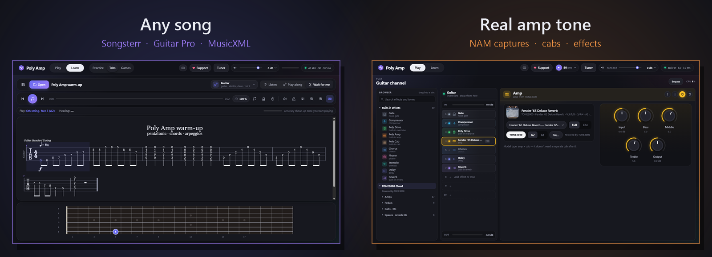
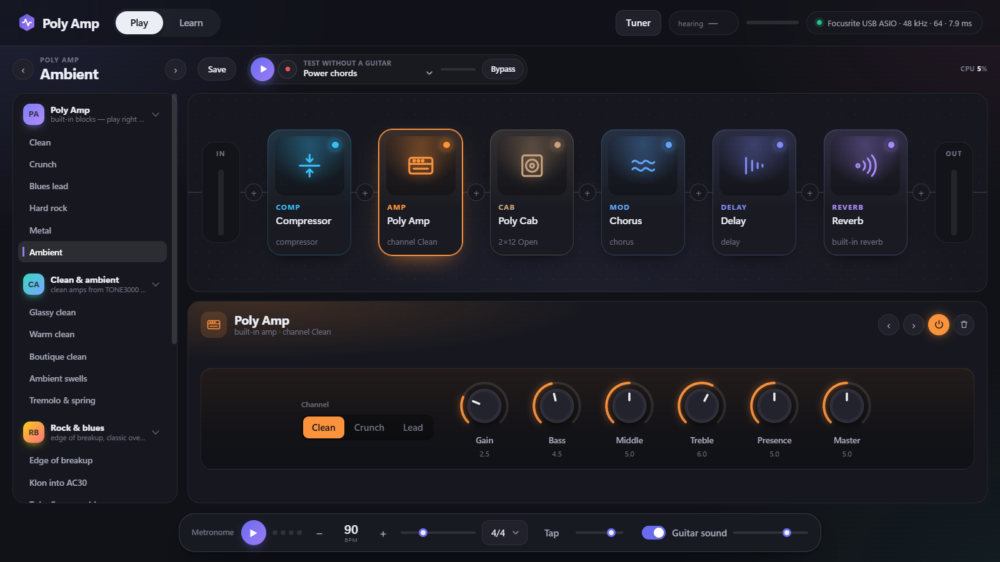
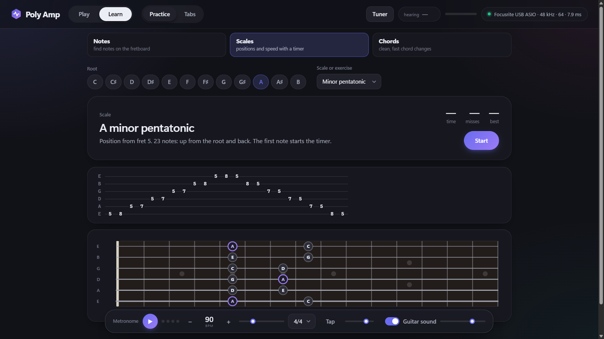

# Poly Amp

### Guitar Pro tabs + real amp tones. One free app for practice.

Grab songs from Songsterr or open your own Guitar Pro files, plug in your guitar and play along: your guitar sounds
through captures of real amps and pedals while the rest of the band plays from the tab. Poly Amp hears every note and
shows what you hit and what you missed.

[](../../releases/latest)
[](LICENSE)



**One window instead of four:** a tab player, an amp sim, a tuner and a metronome.

## Why Poly Amp

- 📥 **Songsterr tabs straight into your library.** Copy a song link on Songsterr and press **Ctrl+V** in Poly Amp.
  Songsterr opens right in the app; hit their Guitar Pro download (a free account is enough) and the tab lands in your
  library, ready to play. Got your own Guitar Pro files? Point the app at the folder.
- 🔥 **Practice that sounds like playing.** Drilling a song through a thin clean tone gets old fast. Here your guitar
  runs through neural captures of real amps and pedals ([NAM](https://www.neuralampmodeler.com)), with thousands of
  free ones on [TONE3000](https://www.tone3000.com), plus built-in amps, drives, cabs, delay and reverb. A ready
  chain plays right away.
- 🎼 **Learn it your way.** Slow a song down, loop the hard part, count in, solo or mute any track, follow it on the
  fretboard.
- 👂 **It actually listens.** *Play along* marks every hit and miss. *Wait for me* stops until you play the right note.
  No more faking your way through the hard bars.
- 🎯 **Skills, not just songs.** Find notes on the fretboard, run scales against the clock, drill chord changes. No
  buttons to press, just play.
- 🆓 **Free. For real.** No subscription, no ads, no account needed to play. Open source.

| Your guitar through real amps and pedals | Scales and chords that listen |
| --- | --- |
|  |  |

## What you need

- A **Windows 10 or 11** PC (64-bit).
- A guitar and an **audio interface**: a small USB box with a guitar input (Focusrite Scarlett, Behringer UMC,
  Steinberg UR, M-Audio, PreSonus… any will do). Install its driver from the maker's website.
- Headphones or speakers.

No interface yet? You can still try tabs and practice with your computer's sound card or a USB headset and a free
driver: [FlexASIO](https://github.com/dechamps/FlexASIO) or [ASIO4ALL](https://asio4all.org/).

## Get started

1. Download **`PolyAmp-win-x64.zip`** from [Releases](../../releases/latest), unzip it anywhere and run
   **`PolyAmp.exe`**. There is no installer and nothing else to install.
2. If you have one audio interface, the app connects to it by itself. Otherwise **Audio settings** opens (the status
   button at the top right): pick your interface and the input your guitar is plugged into. On the interface, turn on
   **Inst** (Hi-Z) and turn off **Direct Monitor**.
3. Play: a basic chain is already set up. Drag effects and amps from the browser on the left into the channel to
   build your own.

## FAQ

**Is it really free?**
Yes. Poly Amp is open source under the MIT license. There's no paid version and no ads.

**Do I need an audio interface?**
To play your guitar through it, yes: a guitar needs a proper instrument input, and inexpensive interfaces work fine.
To look around and practice without a guitar, no (see [What you need](#what-you-need)).

**Can I use it without a guitar?**
Yes. Tabs play back on their own, and in the exercises you can click the fretboard instead of playing.

**What are NAM and TONE3000?**
NAM (Neural Amp Modeler) is a free, open technology that copies the sound of a real amp or pedal with a neural
network. TONE3000 is a website where players share thousands of these captures for free. Poly Amp plays them in a full
chain with cabs and effects.

**How is it different from the NAM plugin?**
The official NAM plugin loads one capture and a cab, mostly inside a DAW. Poly Amp is a standalone app for playing and
practicing: a whole chain of captures and effects, the TONE3000 catalog built in, plus tabs and exercises.

**Is the latency OK?**
With an audio interface, a few milliseconds round trip, which you won't notice. Universal drivers (FlexASIO,
ASIO4ALL) add more.

**Windows says "Windows protected your PC". Is it safe?**
The app isn't code-signed yet, so Windows warns about every new download from an unknown publisher. Click
**More info → Run anyway**. Release builds are made by GitHub Actions straight from this source code.

**Mac or Linux?**
Not yet: the app is built on Windows audio drivers (ASIO) and WebView2.

## Using Poly Amp

### Play: the effects chain

The screen is laid out like a DAW mixer: the **browser** on the left, the **guitar channel** with insert slots in the
middle (top to bottom: IN, the chain, OUT) and the selected slot's window with its knobs on the right.

- **Browser**: built-in effects, your **VST3 plugins** and **TONE3000 Cloud** (the tones you've downloaded plus
  **Browse the catalog…** for amps, pedals, cabs and spaces). Search filters everything. Drag a row into a slot, or
  double-click it (Enter, “+”) to add it after the selected slot.
- **VST3 plugins**: press **Find my plugins** once; the app lists the VST3 effects installed in
  `C:\Program Files\Common Files\VST3` (instruments are skipped) and picks up new ones by itself afterwards, or on
  **Rescan plugins**. A plugin opens in its own window when you add it; reopen it with **Open plugin window** or a
  double-click on its slot. Its settings are saved automatically and come back next time. Plugins without their own
  info file are probed in a separate process, so a broken plugin can't crash the app while scanning.
- **Channel**: drag slots to reorder, the LED turns a block on and off, a click on an empty slot opens the add menu.
  The chain can be as long as you like. **IN and OUT** are global levels: input gain, output level and mute.
- In a TONE3000 block, **TONE3000** opens their catalog in an app window, **File…** loads your own `.nam` or `.wav`,
  and the list shows the tones you've already downloaded. NAM A1, A2 and LSTM models, cab and room impulse responses
  are supported; A2 models have a **Full / Lite** switch (Lite is lighter on the CPU).
- If an amp capture includes a cab, separate cabs after it switch off automatically; an amp without a cab gets a hint
  to add one.
- **Bypass** (or **B**) turns the whole chain off so you can compare with the dry guitar.

### Learn: practice and tabs

- **Practice** has three exercises: **Notes** (find the note on the given string, 20 per round), **Scales**
  (pentatonics, blues, major, minor and a chromatic exercise, with tab and a timer) and **Chords** (14 open chords and
  progressions, timed changes).
- **Tabs** opens Guitar Pro (.gp, .gpx, .gp5, .gp4, .gp3) and MusicXML files with **Open**, drag and drop, or the
  **Library**: choose a folder and every tab file in it and its subfolders appears, grouped and searchable (the app
  only reads tab files there). **Tracks** sets which track to show and play plus volume, mute and solo for each track;
  the indicators light up on every note a track plays. The player has speed (25–125 %), loop (select bars with the
  mouse), metronome click, count-in, reverb, zoom and a fretboard view. Modes: *Listen*, *Play along* (your track is muted,
  hits and misses are marked) and *Wait for me*. Tab audio goes to the Windows default output device.
- **Songsterr**: copy a song link on [Songsterr](https://www.songsterr.com) and press **Ctrl+V** on the Tabs screen
  (or use the download buttons, or type a band or song). Songsterr opens in an app window. It asks you to sign in once
  (a free account works); then press their download button and choose **Guitar Pro**. The file lands in your library
  folder (subfolder `Songsterr`) and opens.

Without a guitar you can click the fretboard: the built-in synth plays the note and the app “hears” it.

### Volume

**Master** at the top of the window sets the volume of everything the app plays: guitar, metronome and tabs. The
meter under it shows the output level, ▾ opens the mix (Master, Guitar, Metronome, Tabs), and **0** mutes everything.

### Keyboard shortcuts

Press **F1** (or the keyboard button at the top) for the full list. The main ones: **Space** play / pause,
**Ctrl+1 / 2 / 3** switch between Play, Practice and Tabs, **T** tuner, **M** metronome, **− / +** slower / faster,
**0** mute all sound.
In Tabs: **← / →** a bar back / forward, **Home** back to start, **L** loop, **1 / 2 / 3** Listen, Play along,
Wait for me. On Play: **B** bypass, **↑ / ↓** previous / next slot, **Delete** removes the selected slot. Shortcuts
work with any keyboard layout.

### TONE3000

Poly Amp uses the [TONE3000 API](https://www.tone3000.com/api) with your own TONE3000 account: you sign in in the app
window, and tones download to `Documents\Poly Amp\Tones`. Choosing tones from the catalog needs an app key
(*publishable key*) from your account settings on tone3000.com; the app asks for it the first time. Tones belong to
their creators and carry the licenses they chose. Powered by TONE3000.

## Audio setup and troubleshooting

- **The driver won't open**: another program (a DAW, a browser tab) may be holding the interface; close it.
  Some drivers allow only one app at a time.
- **Crackles**: raise the buffer in the driver panel (**Audio settings → Driver panel…**); 64–128 samples is
  unnoticeable, ASIO4ALL usually needs 256–512. Two or three neural models at once also load the CPU, so switch A2
  models to **Lite**.
- **Sample rate**: on first launch the app sets 48 kHz if the interface supports it, because neural models are
  designed for 48 kHz (at other rates they sound slightly different and the app warns you). You can choose another rate
  in Audio settings.
- **Hearing the dry guitar on top**: turn off Direct Monitor on the interface.
- **Quiet guitar**: set the gain knob on the interface so hard strums don't clip, then use **Gain** on the IN slot.
- **Tab playback is silent**: tabs use the Windows default output device; make your interface (or headphones) the
  default device.
- **The app asks for WebView2**: the UI runs on the Microsoft Edge WebView2 Runtime, which comes with Windows 11 and
  almost every Windows 10. If it's missing, the app offers the download page.
- **Older CPUs**: neural models use AVX2 when the CPU has it and a compatible build otherwise, picked automatically.

Settings are stored in `%LOCALAPPDATA%\Lad`; downloaded tones in `Documents\Poly Amp`.

## Support the project

Poly Amp is free and will stay free. If it helps you play, you can help it grow:

- ⭐ **Star this repository.** It's the easiest way to help other guitarists find it.
- 🗣️ **Tell a friend** or share it in your guitar community.
- 🐞 **Report bugs**, especially with your audio interface, driver, buffer size and sample rate.
- 💎 **Donate in crypto.** Send only the listed coin on the listed network. Coins sent on any other network are lost.

| Coin | Network | Address |
| --- | --- | --- |
| USDT | TRON (TRC-20) | `TG7dDuWyayxfNRWzjEp7yBvVKjz3g3tNYF` |
| USDT | BNB Smart Chain (BEP-20) | `0x8846e0340A85f2058F0C79407714A06E33038CD2` |

## Building from source

Requirements: **Windows 10/11 x64**, the [.NET 10 SDK](https://dotnet.microsoft.com/download) and
**Visual Studio 2022** (any edition) with the *Desktop development with C++* workload (for the NAM library and the
VST3 host).

```bash
git clone --recursive https://github.com/danksheeet/poly-amp.git
cd poly-amp
build.bat
```

`build.bat` builds the NAM library (`native\namcore\build.bat`, two variants: AVX2 and SSE2) and the VST3 host
(`native\vst3host\build.bat`) once, then publishes a self-contained app into `dist`. Run `dist\PolyAmp.exe`, or zip `dist` to share it. If you cloned without
`--recursive`, run `git submodule update --init --recursive` first.

There's also a **web version** of the UI for trying the exercises without installing anything: `npm start` (or
`start.bat`), then open <http://localhost:5173>. It has no effects chain and noticeable latency, because browsers
can't do better.

### Self-tests

The app has headless self-tests that write a report to a file:

```
PolyAmp.exe --dsptest out.txt      effects chain, note and chord recognition, ASIO sample formats, buffer sizes,
                                   NAM models (both library variants) checked against a reference implementation,
                                   the VST3 host (error handling, plugin info files)
PolyAmp.exe --asiotest out.txt     opens the first ASIO driver that works (or: --asiotest out.txt "Driver name") for a few
                                   seconds with the output muted and measures the callback
PolyAmp.exe --sstest out.txt       Songsterr window: saving downloads into the library, duplicates, file names
PolyAmp.exe --screenshot out.png   starts the app, saves a screenshot of the UI and exits
```

Set `POLYAMP_NAM=sse2` to force the SSE2 build of the NAM library (to test the fallback on any machine).
GitHub Actions builds the app and runs `--dsptest` on every push; version tags (`v*`) publish a release zip.

### Project structure

```
native/                 the app: .NET 10, WinForms + WebView2, NAudio ASIO
  AudioEngine.cs        ASIO host: driver callback, sample formats, global levels, applying the chain
  Blocks.cs             chain blocks and the chain itself
  BuiltinRig.cs         built-in drive, three-channel amp and cabs
  Dsp.cs, LongConvolver.cs, Ir.cs   filters, delay, reverb, FFT convolution, impulse responses
  Nam.cs, NativeNam.cs  .nam models: the official NAM library (namcore.dll) and a built-in fallback (A1, LSTM)
  Analysis.cs, Synth.cs pitch and chord detection, reference notes and the metronome
  Vst3.cs               VST3 plugins: the bridge to vst3host.dll, the chain block, scanning, plugin windows
  Tone3000.cs           TONE3000 client and window
  Songsterr.cs          Songsterr window: their Guitar Pro download goes straight into the tab library
  MainForm.cs           the window and messaging with the UI
  Tests.cs, NamTests.cs self-tests
  namcore/              C wrapper around the NAM library and its build script
  vst3host/             C wrapper around the VST3 SDK hosting classes and its build script
  third_party/          NeuralAmpModelerCore (with Eigen) and the VST3 SDK (git submodules)
public/                 the UI (HTML/CSS/JS, no build step), shared by the app and the web version
  js/modes/             Play (rig.js), exercises, tabs (tabs.js) and the tab library (tablib.js)
  js/rig/               browser, channel slots, block window, TONE3000 tones (js/blocks.js: block types, starting chain)
  vendor/alphatab/      alphaTab with three small fixes (see PATCHES.md), notation font, sound bank
licenses/               license texts of third-party components (copied into every build)
```

## Contributing

Issues and pull requests are welcome. Bug reports with your audio interface, driver, buffer size and sample rate are
especially useful. Code comments are currently in Russian; translations are welcome too.

## License

Poly Amp is released under the [MIT License](LICENSE). It uses third-party components under their own licenses: NAM
core (MIT), Eigen (MPL 2.0), NAudio (MIT), WebView2 SDK, alphaTab (MPL 2.0), the Bravura font (OFL) and the Sonivox
sound bank (Apache 2.0); see [THIRD_PARTY_NOTICES.md](THIRD_PARTY_NOTICES.md).

Not affiliated with Arobas Music (Guitar Pro), Steinberg, TONE3000 or Songsterr. Guitar Pro is a trademark of Arobas
Music; Poly Amp only opens its file formats. VST is a registered trademark of Steinberg Media Technologies GmbH. Amp
and pedal names in tone titles are trademarks of their owners and are used only to describe the captured gear.
